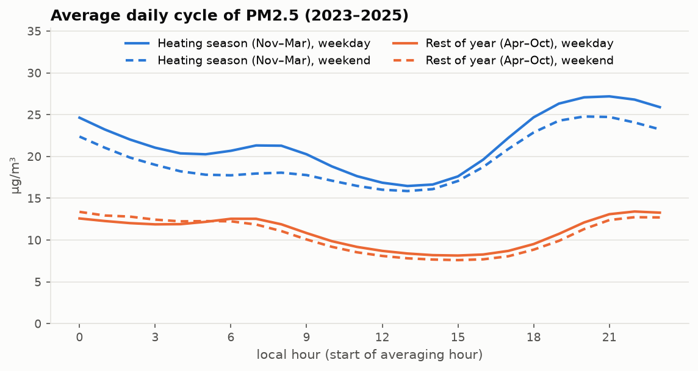
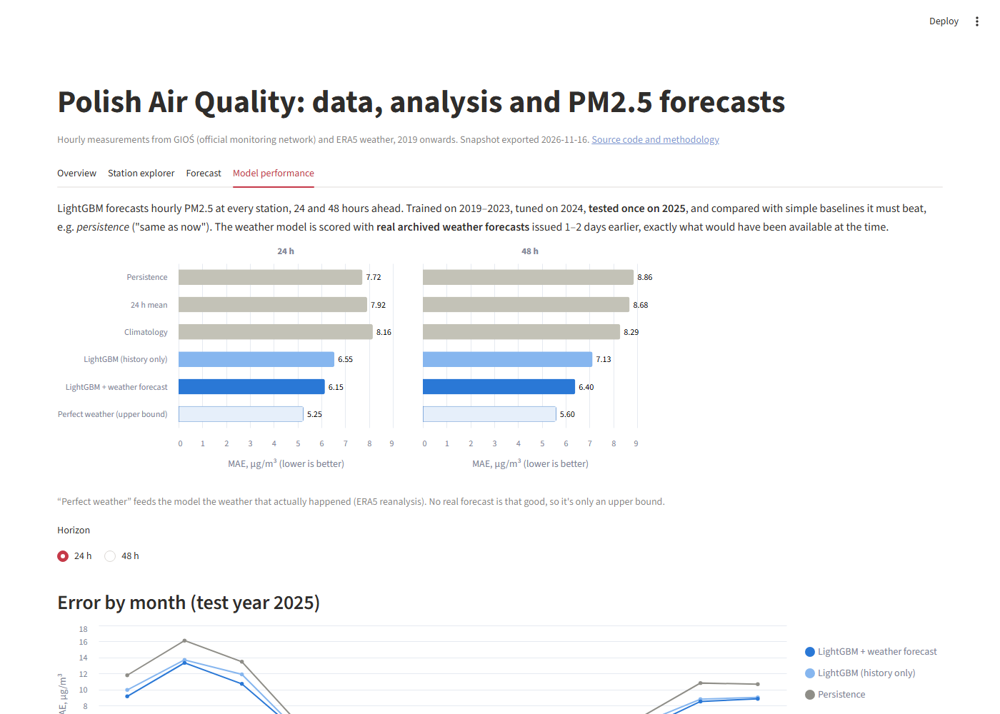

# Polish Air Quality: Forecasting & AI Assistant

An end-to-end data project on air pollution in Poland. It collects official hourly
measurements from the national monitoring network (GIOŚ) and weather data into a
PostgreSQL warehouse, analyses seven years of smog, forecasts PM2.5 24 and 48 hours
ahead at every station, and serves the results through interactive dashboards and a
local LLM assistant that answers questions in English or Polish.

**Live demo:** [open the dashboard on Streamlit Community Cloud](https://air-quality-forecasting-9jvwnwva3kgntaijidn3qv.streamlit.app/)

**Highlights**
- **24 million hourly measurements** from 2019 onwards. An automated, gap-free daily
  update covers PM2.5, PM10 and NO₂ at 219 stations.
- **PM2.5 forecasts 20–28 % more accurate than persistence**, measured with *real
  archived weather forecasts* on a held-out year (not with perfect hindsight weather).
- **A local AI assistant**: text-to-SQL, live forecasts and retrieval over WHO/EU
  guidelines. It scores **92 % on a held-out test set** and works through a
  read-only database role.
- **Dashboards:** a Streamlit app (map, station explorer, live forecasts, model
  performance) and a Power BI-ready star schema.


## What's inside

| Component | What it does | Where |
|---|---|---|
| Data pipeline | GIOŚ yearly archives + REST API and Open-Meteo weather → PostgreSQL, idempotent and resumable | [src/airquality/ingest](src/airquality/ingest), [sql/schema.sql](sql/schema.sql) |
| Analysis | Data quality, trends against WHO/EU standards, seasonal and daily cycles, geography, weather drivers | [notebooks/01_eda.ipynb](notebooks/01_eda.ipynb) |
| Forecasting | LightGBM 24/48 h forecasts, smog-alert classifier, realistic evaluation | [src/airquality/forecast](src/airquality/forecast), [notebooks/02_forecasting.ipynb](notebooks/02_forecasting.ipynb) |
| Dashboards | Streamlit app; `bi` star schema and Power BI guide | [app/](app), [sql/bi.sql](sql/bi.sql), [docs/powerbi_guide.md](docs/powerbi_guide.md) |
| AI assistant | Local LLM (Qwen2.5 7B via Ollama) with SQL, forecast and RAG tools, plus an evaluation suite | [src/airquality/assistant](src/airquality/assistant), [evals/](evals) |

## Air quality in Poland, 2019–2025

From the [analysis notebook](notebooks/01_eda.ipynb):

- **PM2.5 fell ~20 %** (network mean 19.4 → 15.5 µg/m³). It now meets the EU annual
  limit but is still ~3× the WHO 2021 guideline, and about a third of station-days
  exceed the WHO daily guideline.
- **Smog is a heating-season problem.** October–March levels are about twice the
  summer level, peaking in the evening when homes are heated with solid fuels.
- **Weather decides the episodes.** Cold, calm air under a low boundary layer traps
  pollution near the ground (Spearman ρ with PM2.5: boundary layer height −0.48,
  temperature −0.43).
- **Kraków improved the most among large cities.** It went from 4th most polluted
  (2019) to 18th of 72 (2025), after banning coal and wood for home heating.



## Forecasting PM2.5

At every hour, the model predicts each station's PM2.5 24 and 48 hours ahead. It was
trained on 2019–2023, tuned on 2024, and **tested once on 2025**.

Mean absolute error on the 2025 test year, in µg/m³ (lower is better):

| Model | 24 h ahead | 48 h ahead |
|---|---|---|
| Persistence ("same as now") | 7.72 | 8.86 |
| Climatology (station × month × hour average) | 8.16 | 8.29 |
| LightGBM, pollution history only | 6.55 | 7.13 |
| **LightGBM + real weather forecasts** | **6.15** (−20 %) | **6.40** (−28 %) |
| LightGBM + perfect weather *(upper bound)* | 5.25 | 5.60 |

- **Honest weather evaluation.** Training uses ERA5 reanalysis, i.e. the weather that
  actually happened. The headline row instead feeds the model archived forecasts issued
  1–2 days earlier (Open-Meteo Previous Runs API), which is what it would have had in
  practice. Forecast error costs about 0.6 µg/m³ compared with perfect weather.
- **Where it helps.** The gain is largest on polluted winter days. With weather
  forecasts, the model sees smog episodes coming and beats persistence even above
  50 µg/m³. It still under-predicts the sharpest peaks.
- **Smog alerts.** A separate classifier estimates the chance of PM2.5 above
  50 µg/m³. From pollution history alone it already beats the "bad now, so bad
  tomorrow" rule (F1 0.40 vs 0.35), and weather lifts it further.
- **No look-ahead leakage.** A unit test corrupts all future data and checks that
  features don't change. Time splits drop rows that straddle a boundary.


## AI assistant

A local model (Qwen2.5 7B served by Ollama on a 6 GB GPU) answers questions in English
or Polish, using three tools:

| Tool | What it does |
|---|---|
| `run_sql` | Writes and runs SQL over the `bi` star schema |
| `get_forecast` | Latest 24/48 h PM2.5 forecast for a city |
| `search_guidelines` | Retrieval over WHO 2021 guidelines, EU law, health advice and the project's methodology, with citations |

**Safety.** The assistant connects as a PostgreSQL role that can only read the `bi`
views, in read-only sessions with a statement timeout. Queries are also checked
(single `SELECT`) and row-capped. Tests confirm that the database itself refuses writes
and raw-table access even if the check is bypassed.

**Evaluation.** Ground truth for data questions comes from reference SQL run at
evaluation time, so the test set stays correct as data updates.

| Test set | Questions | Accuracy |
|---|---|---|
| Development set (the prompt was iterated on it) | 30 (data, forecast, guidelines, safety) | 100 % |
| **Held-out set** (never used for tuning) | 12 | **92 %** (11/12) on its first run |

The held-out miss was a weekday-vs-weekend comparison. A later re-run, after data and
station updates, scored 12/12, but the first run is the honest figure. Median answer
time is about 11 seconds. `streamlit run app/assistant_app.py` opens a
chat window that shows every tool call and SQL query behind each answer.

## Dashboards

- **Streamlit app** ([live](https://air-quality-forecasting-9jvwnwva3kgntaijidn3qv.streamlit.app/),
  [app/streamlit_app.py](app/streamlit_app.py)) has four tabs:
  national overview with a station map, station explorer, live forecasts with smog-alert
  probabilities, and model performance. It reads a 2 MB Parquet snapshot instead of the
  database, so it can be deployed on Streamlit Community Cloud as is.
- **Power BI.** The `bi` schema is a star schema with station, date and threshold
  dimensions, plus daily air-quality and forecast-vs-actual facts in Polish local time.
  [docs/powerbi_guide.md](docs/powerbi_guide.md) covers the connection, relationships,
  DAX measures and report pages.



## How it works

```
GIOŚ yearly archives (xlsx) ─┐
GIOŚ REST API ───────────────┼──▶ ingestion (Python) ──▶ PostgreSQL ──▶ daily_station view ──▶ bi star schema
Open-Meteo ERA5 + forecasts ─┘   upserts, watermarks,     measurements,                           │
                                 retries, quotas          weather, forecasts                      │
                                                                ▲                                 ▼
                         LightGBM training + live forecasts ────┘          Streamlit · Power BI · LLM assistant
```

Everything runs from one command-line tool (`airquality --help`), and every load is
recorded in an `ingestion_runs` table.

## Engineering notes

Some of the more interesting problems, and how they were solved:

- **Timestamps.** GIOŚ reports fixed CET (UTC+1) all year, labelling the *end* of each
  hour. Everything is stored in UTC. Daily means use Polish local days, so a
  daylight-saving day has 23 hours. Database sessions are pinned to UTC: an `extract(year)`
  in the server's local time had been counting the last hour of 2025 as 2026.
- **Trustworthy upserts.** Official yearly files outrank the archival API, which
  outranks live data, so provisional values can never overwrite verified ones. Each
  sensor keeps a `loaded_until` watermark, so incremental loads can't leave gaps.
- **A misleading validation set.** ERA5 has no boundary layer height for January–June
  2024, half the validation year. Early stopping on it halted after about 25 trees and
  made weather look nearly useless. Validating on complete rows fixed it: the 24 h
  error dropped from 6.15 to 5.25 µg/m³ with ERA5 weather.
- **Overfitting to the calendar.** Day-of-year features let the model memorise the
  weather of particular training days. Removing them and regularising the trees
  improved validation error.
- **LLM tool calls.** Ollama's built-in parser silently dropped tool calls when the
  model wrote multi-line SQL. The assistant uses prompt-based tool calling with a
  lenient parser instead. The evaluation also caught silently wrong numbers (averages
  mixing pollutants, month ranges like `BETWEEN 10 AND 3`), which explicit SQL rules fixed.

## Running it

Requirements: Python 3.11+ and PostgreSQL 17 (a local install, or `docker compose up -d`).
The assistant also needs [Ollama](https://ollama.com) with `qwen2.5:7b` and
`nomic-embed-text`.

```bash
cp .env.example .env                     # database passwords
python -m venv .venv && source .venv/bin/activate     # Windows: .venv\Scripts\activate
pip install -e ".[dev,analysis,ml]"

# data
airquality init-db
airquality load-stations
airquality backfill-archive --years 2019-2025
airquality backfill-api --start 2026-01-01
airquality weather-archive --start 2019-01-01
airquality update && airquality weather-forecast && airquality refresh-views   # daily

# models and forecasts
airquality train-forecast --horizon 24 --weather --no-blh   # also --horizon 48; see --help
airquality eval-realistic --horizon 24                      # score with archived forecasts
airquality predict --weather                                # live 24/48 h forecasts

# dashboards and assistant
airquality export-snapshot && streamlit run app/streamlit_app.py
airquality build-index && airquality ask "Which city had the cleanest air in 2023?"
```

Run the tests with `pytest`. The integration tests need a PostgreSQL database named
`airquality_test`; skip them with `pytest -m "not integration"`.

## Repository layout

```
app/                Streamlit dashboard (+ data snapshot) and assistant chat UI
docs/               data-source notes, Power BI guide, assistant knowledge base
evals/              assistant evaluation sets
notebooks/          analysis and forecasting notebooks (paired .py / .ipynb)
reports/            figures and metrics
sql/                schema, analytical views, BI star schema
src/airquality/     ingest/, forecast/, assistant/, CLI
tests/              unit and integration tests
```

## Limitations

- The realistic weather evaluation covers one year (2025). Archived forecasts don't
  include boundary layer height, so the live model is the version trained without it,
  the one whose real-world accuracy was measured.
- Severe smog peaks are still under-predicted. On clean days, the weather model
  sometimes over-predicts when the forecast looks smog-prone.
- The assistant is a 7B model running locally: good at the questions it was tested on,
  but not infallible. Its answers show the SQL behind them for that reason.

## Data sources

- Air quality: [GIOŚ](https://powietrze.gios.gov.pl/), Chief Inspectorate of
  Environmental Protection, Poland.
- Weather: [Open-Meteo](https://open-meteo.com/) (ERA5 reanalysis, forecasts and
  Previous Runs API), CC BY 4.0.
- Reference documents: WHO Global Air Quality Guidelines (2021); EU Directives
  2008/50/EC and (EU) 2024/2881.
