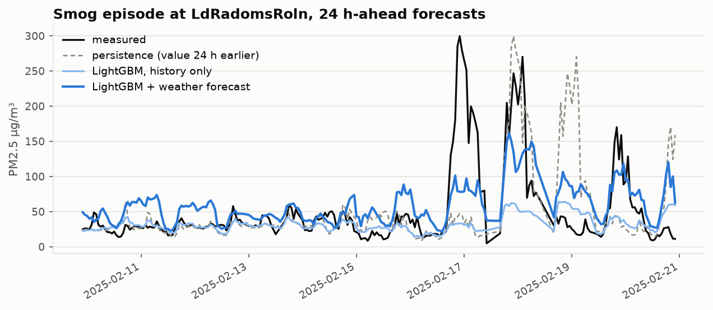
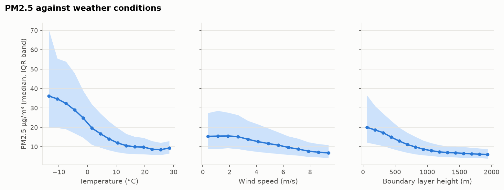
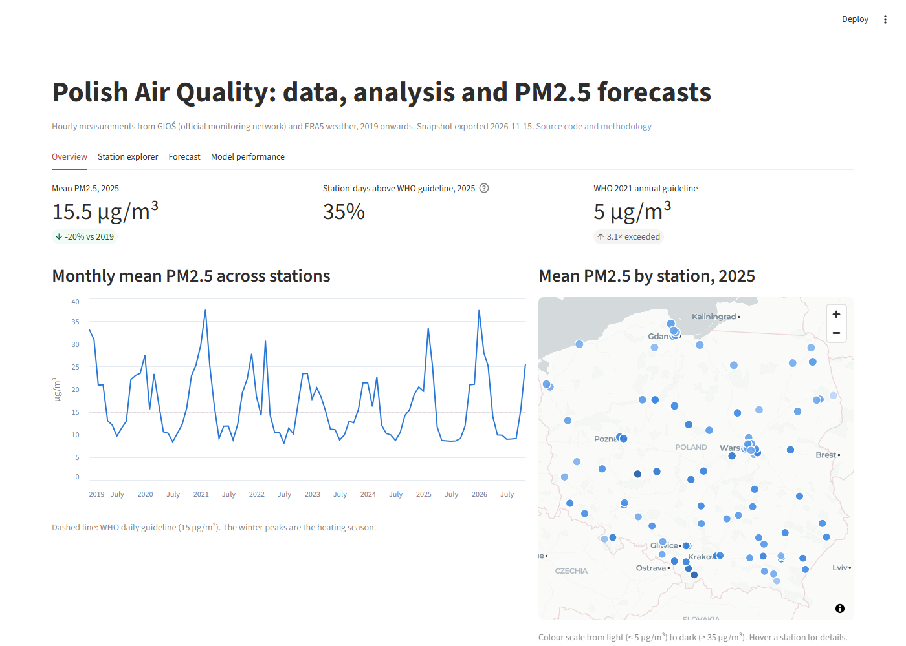

# Air Quality Forecasting & AI Assistant (Poland)

End-to-end data project on Polish air quality: an automated pipeline that loads official
GIOŚ measurements and Open-Meteo weather into PostgreSQL, with PM2.5 forecasting,
a BI dashboard and an LLM assistant planned on top.

> **Status:** data pipeline, analysis, forecasting, dashboards and the AI assistant are
> working. In progress: the forecast model with weather features (the weather backfill is
> limited by the free API quota) and the Power BI report.

## Key findings so far ([full analysis notebook](notebooks/01_eda.ipynb))

- **PM2.5 fell ~20 % from 2019 to 2025** (network mean 19.4 → 15.5 µg/m³). It now
  meets the EU annual limit but is still ~3× the WHO 2021 guideline, and about a third
  of station-days exceed the WHO daily guideline.
- **Smog is a heating-season problem:** October–March daily means are about twice the
  summer level, with an evening peak when homes are heated.
- **Weather decides the episodes:** cold, calm air and a low boundary layer trap
  pollution (Spearman ρ with PM2.5: boundary-layer height −0.48, temperature −0.43).
- **Kraków improved the most among large cities:** it went from 4th worst (2019) to 18th
  of 72 (2025) after banning solid-fuel heating.

## Forecasting results ([notebook](notebooks/02_forecasting.ipynb))

Hourly PM2.5 forecast at each station, 24 h and 48 h ahead (LightGBM, one model per
horizon). Trained on 2019–2023, tuned on 2024, **tested once on 2025**. Mean absolute
error in µg/m³, without weather features:

| Model | 24 h ahead | 48 h ahead |
|---|---|---|
| Persistence (same as now) | 7.72 | 8.86 |
| Mean of last 24 h | 7.92 | 8.68 |
| Climatology (station × month × hour) | 8.16 | 8.29 |
| **LightGBM** | **6.55** (−15 %) | **7.13** (−20 %) |

- **Early warning:** a separate classifier for high-pollution hours (> 50 µg/m³)
  catches about half of them, beating the "bad now → bad tomorrow" rule (F1 0.40 vs
  0.35 at 24 h). ROC-AUC is 0.93.
- **Known weakness:** during severe smog (> 50 µg/m³) the point forecast under-predicts
  and is worse than persistence. Pollution history alone can't anticipate an
  inversion, so weather features are next.
- **Engineering:**
  - No-leakage features, verified by a unit test that corrupts future data.
  - Boundary-safe time splits.
  - Hyper-parameters and target transform chosen on validation only.





## Dashboards

- **Interactive web app** ([app/streamlit_app.py](app/streamlit_app.py)) has four tabs:
  national overview with a station map, station explorer, live 24/48 h forecasts with
  smog-alert probabilities, and model performance. It reads a 2 MB Parquet snapshot
  (`airquality export-snapshot`), so it can be deployed free without the database.
  Run it with `streamlit run app/streamlit_app.py`.
- **Power BI**: the database exposes a star schema in the `bi` schema
  ([sql/bi.sql](sql/bi.sql)): station, date and threshold dimensions; daily
  air-quality and forecast-vs-actual facts in Polish local time. Build steps, DAX
  measures and page designs are in [docs/powerbi_guide.md](docs/powerbi_guide.md).



## AI assistant (local LLM)

Ask questions in English or Polish. A local model (**Qwen2.5 7B via Ollama**, on a 6 GB GPU)
answers using three tools:

| Tool | What it does |
|---|---|
| `run_sql` | text-to-SQL over the `bi` star schema |
| `get_forecast` | latest 24/48 h PM2.5 forecast for a city |
| `search_guidelines` | retrieval (RAG) over WHO 2021 guidelines, EU law, health advice and this project's methodology, with source citations |

**SQL safety in layers:**
- A dedicated PostgreSQL role can only `SELECT` from the `bi` views, and its sessions are
  read-only with a statement timeout.
- Queries are also pre-checked (single `SELECT`) and row-capped.
- Tests prove the database itself refuses writes and raw-table access, even if the
  validator is bypassed.

**Evaluation** ([evals/](evals/)): ground truth for data questions comes from reference
SQL run at evaluation time.

| Set | Questions | Accuracy | Notes |
|---|---|---|---|
| Development set | 30 (data, forecast, guidelines, safety) | 100 % | prompt was iterated on this set (93 % → 87 % → 100 %) |
| **Held-out set** | 12, never used for tuning, run once | **92 %** | 1 miss: a weekday/weekend comparison |

Median answer time is about 11 s. Detailed results: `reports/metrics/assistant_eval.json`
and `assistant_holdout.json`.

Problems the evaluation surfaced, and how they were fixed:
- **Ollama's tool parser silently dropped calls with multi-line SQL** (raw newlines inside
  JSON). Fix: prompt-based tool calling with a lenient parser.
- **Silently wrong numbers** from mixing pollutants in one average, and wrap-around month
  ranges (`BETWEEN 10 AND 3` matches nothing). Fix: explicit SQL rules.
- **SQL written as text instead of executed.** Fix: a code-level recovery step.
- **One unfair test item** where the correct answer was a tie. Fix: replaced, with a note
  in the eval file.

```bash
airquality build-index                 # read-only DB role + embed docs/knowledge/
airquality ask "Which city had the highest average PM2.5 in 2024?"
streamlit run app/assistant_app.py     # local chat UI showing every tool call and SQL query
airquality eval-assistant [--holdout]
```

## What's built so far

- **PostgreSQL warehouse** ([sql/schema.sql](sql/schema.sql)): stations, sensors, hourly
  measurements (PM2.5, PM10, NO₂), hourly weather, and an `ingestion_runs` job log.
  All timestamps are UTC and mark the end of the averaging hour.
- **GIOŚ ingestion**:
  - Yearly official archives (2019–2025, ~20M hourly rows) parsed from xlsx.
  - REST API for the current year and daily incremental updates.
  - Each sensor keeps a `loaded_until` watermark, so incremental loads never leave gaps.
- **Source precedence**: official yearly files > archival API > live data. Provisional
  values can never overwrite verified ones (enforced in the upsert).
- **Weather ingestion** (ERA5 reanalysis + forecast, incl. boundary-layer height):
  - Stations in the same 0.25° grid cell share one request.
  - Loads are resumable and quota-aware (Open-Meteo free tier).
- **Engineering**:
  - Idempotent bulk upserts via `COPY`.
  - Retries with backoff and overall time caps.
  - 107 tests (unit tests with mocked HTTP + integration tests on a separate test database).

Data-source details and quirks (fixed-CET timestamps, rate limits, archive layout) are
documented in [docs/data_sources.md](docs/data_sources.md).

## Quick start

```bash
cp .env.example .env            # set the Postgres password
docker compose up -d            # or use a local PostgreSQL 17 install
python -m venv .venv && source .venv/bin/activate   # Windows: .venv\Scripts\activate
pip install -e ".[dev,analysis,ml]"

airquality init-db
airquality load-stations
airquality backfill-archive --years 2019-2025
airquality backfill-api --start 2026-01-01
airquality weather-archive --start 2019-01-01
airquality update               # daily incremental load
airquality refresh-views        # recompute daily means (analytics + BI layer)

airquality train-forecast --horizon 24     # train + evaluate (also --horizon 48, --weather)
airquality load-backtests       # test-year predictions -> forecasts table (dashboards)
airquality predict              # live 24/48 h forecasts from the latest data
airquality export-snapshot      # refresh the web app's data snapshot
```

Run the tests (integration tests need a database named `airquality_test`):

```bash
pytest                          # or: pytest -m "not integration"
```

## Roadmap

1. ~~Data pipeline~~ ✅
2. ~~Exploratory analysis~~ ✅: SQL analytical layer (`daily_station` view, WHO/EU thresholds) + notebook
3. PM2.5 24–48 h forecasting: ~~baselines → LightGBM~~ ✅, episode classifier ✅; next: weather features, deep learning comparison
4. Dashboards: Streamlit app ✅, Power BI star schema + guide ✅ (report: in progress)
5. ~~LLM assistant~~ ✅ (local Qwen2.5 7B via Ollama): text-to-SQL, forecast tool, RAG,
   evaluated on development + held-out sets
6. Next: weather-feature forecast model (once the weather backfill completes), Power BI report

## Data sources

- Air quality: [GIOŚ](https://powietrze.gios.gov.pl/) (Chief Inspectorate of Environmental Protection, Poland)
- Weather: [Open-Meteo](https://open-meteo.com/) (ERA5 reanalysis, CC BY 4.0)
